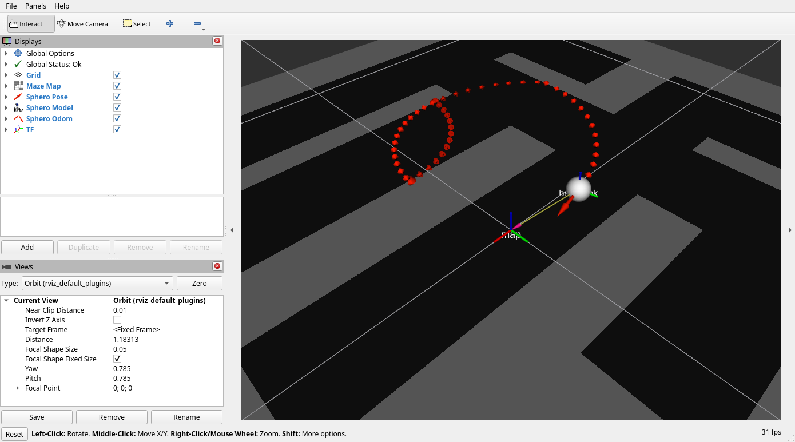

# sphero-monash-ros

This repository is a ROS 2 wrapper around a basic sphero simulator and hardware backends.

Control and state interfaces follow standard ROS conventions:
1. Input command topic: geometry_msgs/Twist on /cmd_vel
2. Output pose topic: geometry_msgs/PoseStamped on /sphero/pose
3. Output odometry topic: nav_msgs/Odometry on /sphero/odom
4. Output map topic: nav_msgs/OccupancyGrid on /sphero/map
5. Output transform: map -> base_link via TF
6. Real robot IMU topic: sensor_msgs/Imu on /sphero/imu
7. Real robot collision topic: std_msgs/Bool on /sphero/collision



## Environment Management (Pixi-first)

This project uses Pixi with RoboStack (ROS 2 Humble) for reproducible setup.

Install Pixi, then from the repository root run:

```bash
pixi install
```

Optional editable install for external scripts:

```bash
pixi run develop
```

## Run

Start simulator wrapper node:

```bash
pixi run sim-node
```

Start simulator with RViz:

```bash
pixi run sim-launch
```

Start real robot wrapper node:

```bash
pixi run robot-node
```

Start the real robot visualization launch (in a separate terminal):

```bash
pixi run viz-launch
```

Start keyboard teleop node:

```bash
pixi run teleop-node
```

Teleop publishes planar velocity vectors using the `qwe/asd` layout: lowercase
`q/w/e` are forward-left/forward/forward-right, `a/s/d` are left/backward/right,
`+/-` adjust speed, `SPACE` stops, and uppercase `Q` quits. The wrappers
convert `linear.x/y` into Sphero speed magnitude and heading; `angular.z` is
ignored.

The real robot node must be run separately because its Sphero scanner is
interactive. Use three terminals:

1. `pixi run robot-node` scans for and connects to the robot.
2. `pixi run viz-launch` starts `robot_state_publisher` and RViz without taking
   over terminal input.
3. `pixi run teleop-node` reads keyboard commands and publishes `/cmd_vel`.

## ROS Nodes

1. sphero_ros.nodes.sim_wrapper_node
2. sphero_ros.nodes.robot_wrapper_node
3. sphero_ros.nodes.teleop_node

Both nodes subscribe to /cmd_vel and publish /sphero/pose, /sphero/odom,
/sphero/collision, and TF.

The real robot wrapper additionally publishes the Sphero acceleration, gyroscope,
and orientation data as `/sphero/imu` in SI units (`m/s^2`, `rad/s`, and a
quaternion), with `base_link` as the frame. The simulator publishes the same
collision topic from its contact model.

The simulator uses a generated maze by default and publishes it as /sphero/map.

